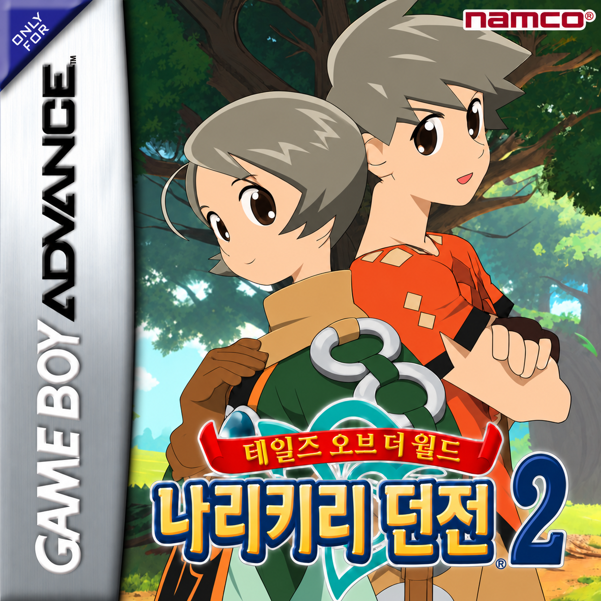

# 테일즈 오브 더 월드 나리키리 던전 2 한국어화



**[v1.1d 프리릴리즈 다운로드](https://github.com/GimoXagros/gba-narikiri2-kor/releases/tag/v1.1d)**

퀘스트 대사의 목표물과 스펙터클즈 전투 정보창에서 깨지던 글자를 수정했습니다. 전투·결과 화면의 TARGET, HIT, BONUS, EXP, GALD는 일본어판 그래픽으로 복원했습니다. 코스튬 여섯 종의 명칭과 VBA-M에서 첫 마을의 SELECT 메뉴를 열 때 발생하던 멈춤도 수정했습니다.

## 패치 적용

릴리스에서 `Xagros_Narikiri2_KOR_v1.1d_JP_PACKAGE.zip`을 받아 새 폴더에 풉니다. 수정하지 않은 일본어 원본(AN9J)과 Python 3.10 이상을 사용합니다.

```powershell
python apply_japanese_patch.py Japanese.gba --output Xagros_Narikiri2_KOR_v1.1d.gba
```

결과 ROM은 8,388,608바이트이며 SHA-256은 `705d92a147ac1e3bd4830ca976154dd397c67263ad99dcd04a8dd5313d9e0177`입니다. 원래 포인터와 문자열 시작 위치 10,371개를 확인했습니다. [적용·빌드·My Boy 확인 순서](docs/V11D_PACKAGE.md) · [검증 결과](verification/v1.1d.json) · [코스튬 변경 목록](docs/issue25-names.csv)

가상 mGBA에서 첫 의뢰와 두 후속 의뢰의 수주·지역 입장, 전투 결과, 일반 저장과 중단 저장 복원을 확인했습니다. 가상 VBA-M에서도 SELECT 메뉴와 실제 전투 결과를 확인했습니다. My Boy Premium과 실기는 미검증입니다. 정식 배포는 [v1.1](https://github.com/GimoXagros/gba-narikiri2-kor/releases/tag/v1.1)입니다.

## 이전 v1.1c 기록

큰 글자 단어 간격은 6px, 지원되는 소형 문자열은 4px로 표시합니다. 숫자 열·들여쓰기·이름 입력판·사용자 이름과 숨겨진 개발용 목록의 예외는 보존합니다. `아니요`는 이전 느낌을 유지한 그래픽으로 교정했습니다. 10,371개 원래 포인터와 문자열 시작 위치, 8MiB 크기는 유지합니다.

분리된 소스 폴더에서 ROM/BPS 재현, 실제 CPU 디코더와 코드 경계, 고정 목록 7,330회 이동, 가상 화면·일반 저장 두 번 불러오기·중단 저장·펍 로즈 SGM 복원을 최종 해시로 검증했습니다. 상세 수치와 범위는 [v1.1c 릴리스 노트](docs/RELEASE_NOTES_V11C.md), [적용·빌드 안내](docs/V11C_PACKAGE.md), [검증 계약](verification/v1.1c.json), [관문별 증거](verification/v1.1c-evidence.json)를 참조하세요.

기술 설정 제목에 4px 상단 여백을 확보했습니다. 오디오의 한 스테레오 프레임 차이는 시험용 mGBA의 FIFO 타이밍 계산으로 원인을 확인했고 별도 수정 참조 코어와 VBA에서 버전 간 PCM 전체 일치를 확인했습니다. ROM 음원은 수정하지 않았으며 기존 mGBA에는 차이가 남습니다. [원인·소스 수정 기록](docs/AUDIO_TIMING_V11C.md)을 참조하세요. 최종 실기·청취·전체 분기·통신은 미검증이며 이슈 #4를 유지합니다.

## 이전 v1.1a 기록

597개 검토 바인딩 가운데 552개를 교정하고 45개는 유지했습니다. 교정은 원래 문자열 시작 544곳에 반영했고 공백 578개와 화면 지우기 제어 1개를 조정했습니다. 10,371개 바인딩의 포인터·문자열 시작 위치, 8MiB 크기와 보호 구간 52곳은 유지합니다.

2026-10-19 사용자는 수정 사항을 확인하고 v1.1a 업데이트·배포를 요청했습니다. 이를 전달한 최종 교정본에 연결한 `USER_ATTESTED` 수정 수락으로 기록합니다. 사용자가 직접 해시를 대조했다고 추정하지 않으며 기기·에뮬레이터·항목별 검사 내역은 `NOT_REPORTED`입니다.

실제 CPU 명령을 실행한 고정 시험은 `PASS_CPU_FIXTURE_NOT_NORMAL_PLAY`로 구분합니다. 이 결과는 일반 플레이·전체 자연 진행·분기·통신·저장 호환·실기 시험의 통과를 뜻하지 않습니다. v1.1의 실행·성능 기록과 이전 버전의 기기 기록을 v1.1a의 새 검증으로 승계하지 않습니다. 미확인 범위의 [이슈 #4](https://github.com/GimoXagros/gba-narikiri2-kor/issues/4)는 유지합니다.

기존 8KiB 게임 내 저장(SAV)은 먼저 백업하고 ROM/SAV의 파일명을 확장자를 제외하고 맞추세요. 다른 ROM 버전의 강제저장(SGM)은 재사용하지 마세요.

[적용 안내](docs/V11A_PACKAGE.md) · [빌드 안내](docs/V11A_BUILD.md) · [릴리스 노트](docs/RELEASE_NOTES_V11A.md) · [검증 기록](verification/v1.1a.json) · [이전 v1.1](docs/RELEASE_NOTES_V11.md) · [이전 v1.0](https://github.com/GimoXagros/gba-narikiri2-kor/releases/tag/v1.0)

## 출처와 권리

기존 한국어 번역은 FFR 팀의 작업을 출처로 합니다. 달무리 비트맵 글꼴은 별도 Apache-2.0 조건과 출처 고지를 따릅니다. MIT는 신규 코드와 문서에만 적용되며 게임, 기존 번역, 로고의 권리를 바꾸지 않습니다. 공식 제휴·승인이나 ROM 재배포 허가를 뜻하지 않습니다. 자세한 내용은 CREDITS.md, RIGHTS.md, THIRD_PARTY_NOTICES.md를 참조하세요.
