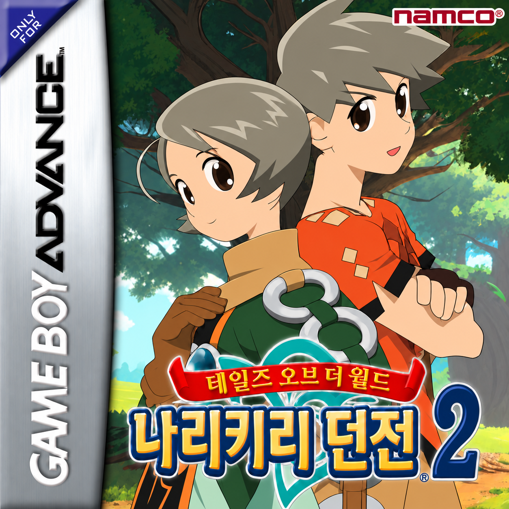

# 테일즈 오브 더 월드 나리키리 던전 2 한국어화



**v1.1**은 일본어 원본 ROM(게임 코드 AN9J)에 직접 적용하는 한국어 패치입니다.
결과 ROM을 원본과 같은 **8MiB**로 통합하고, 원래 텍스트 포인터와 문자열 시작 위치를 유지하면서 목록 표시 성능을 개선했습니다. FFR 패치를 먼저 적용할 필요는 없습니다.

## 적용

[v1.1 릴리스](https://github.com/GimoXagros/gba-narikiri2-kor/releases/tag/v1.1)에서 `Xagros_Narikiri2_KOR_v1.1_JP_PACKAGE.zip`을 받아 새 폴더에 풉니다. Python 3.10 이상을 사용하며 추가 패키지는 필요하지 않습니다.

```powershell
python apply_japanese_patch.py "일본어 원본.gba" --output "Xagros_Narikiri2_KOR_v1.1.gba"
```

수정하지 않은 일본어 원본에 적용합니다. 기존 v1.0 한국어 ROM에 덧붙이는 패치가 아닙니다. 적용기는 원본·패치·결과를 확인하고 기존 출력 파일을 덮어쓰지 않습니다.

| 구분 | 바이트 | SHA-256 |
| --- | ---: | --- |
| 일본어 원본 | 8,388,608 | `a92c0f6dbb5c013b47b7178e23d81663e3952a10df7b1f68967ebf7bb3b98eb7` |
| v1.1 결과 ROM | 8,388,608 | `9fd341b827a8ba282781d7f8f214f2ba8641365b541564d53e9ef5267511889b` |
| 일본어 원본용 BPS | 378,033 | `4e4ad0229b22ea5bd8e6b351adfa79a749e2b5288aabb24d7d1e356a7bfafade` |

ZIP의 크기·해시와 배포 커밋은 릴리스의 `manifest.json`, `SHA256SUMS.txt`에서 확인할 수 있습니다. ROM·개인 저장·전체 대사집은 공개 첨부물에 포함하지 않습니다.

## v1.1 변경

- 13,270,790바이트였던 v1.0 결과를 8,388,608바이트로 통합했습니다. 원본 텍스트 포인터 10,172개와 시작 위치 9,246곳을 유지합니다.
- 압축 문구의 게임 내 복원, 공유 주소 7곳의 문맥별 선택, 이름 저장 경로를 연결했습니다. 새 RAM·저장 필드는 추가하지 않았습니다.
- 타일 검색·글자 합성을 개선했습니다. 고정 가상 코어 시험의 목록 P99는 아이템 8·도감 8·구매 7·판매 7·의상 7·캐릭터 17프레임입니다. 모든 목록이나 실기에서 8프레임 이하라는 의미는 아닙니다.
- 채택한 번역, 부팅 안내, 한국어 타이틀과 엔딩을 보존했습니다. 감사 문구는 `(SPECIAL THANKS)` / `PROTOTYPE` / `AND YOU`를 포함합니다.

## 저장 및 검증 범위

기존 8KiB 게임 내 저장(SAV)은 먼저 백업하고 ROM/SAV의 파일명을 확장자를 제외하고 맞추십시오. 다른 ROM 버전의 강제저장(SGM)은 재사용하지 마십시오. 새 게임·기존 저장·재저장·두 차례 콜드 로드·중단 저장과 같은 ROM의 VBA 가상 코어 SGM을 확인했습니다.

2026-10-11 사용자는 직전에 전달한 8MiB 검증본의 정상 동작을 확인하고 v1.1 공개를 요청했습니다. 이를 해당 검증본에 연결한 USER_ATTESTED 공개 범위 결정으로 기록합니다. 기기·실행 프로그램·항목별 시험 내역과 사용자가 직접 대조한 해시는 별도로 보고되지 않았습니다. 이전 v1.0의 OLD 2DS 검수 기록을 이번 버전의 실기 증거로 옮기지 않습니다.

전체 자연 진행·모든 분기·두 기기 통신·다른 코어의 SGM 호환은 확인 범위에 포함되지 않습니다. 엔딩 화면 자동 검사는 시험용 진입 분기를 사용했습니다. 상세 검사와 한계는 [검증 기록](verification/v1.1.json), [실행부 검증](analysis/v1.1/runtime-integration.md)에 있습니다. 미확인 범위의 [이슈 #4](https://github.com/GimoXagros/gba-narikiri2-kor/issues/4)는 유지합니다.

[적용 안내](docs/V11_PACKAGE.md) · [빌드 안내](docs/V11_BUILD.md) · [릴리스 노트](docs/RELEASE_NOTES_V11.md) · [이전 v1.0](https://github.com/GimoXagros/gba-narikiri2-kor/releases/tag/v1.0)

## 출처와 권리

기존 한국어 번역은 FFR 팀의 작업을 출처로 합니다. 달무리 비트맵 글꼴은 별도 Apache-2.0 조건과 출처 고지를 따릅니다. MIT는 신규 코드와 문서에만 적용되며 게임, 기존 번역, 로고의 권리를 바꾸지 않습니다. 공식 제휴·승인이나 ROM 재배포 허가를 뜻하지 않습니다. 자세한 내용은 CREDITS.md, RIGHTS.md, THIRD_PARTY_NOTICES.md를 참조하십시오.
